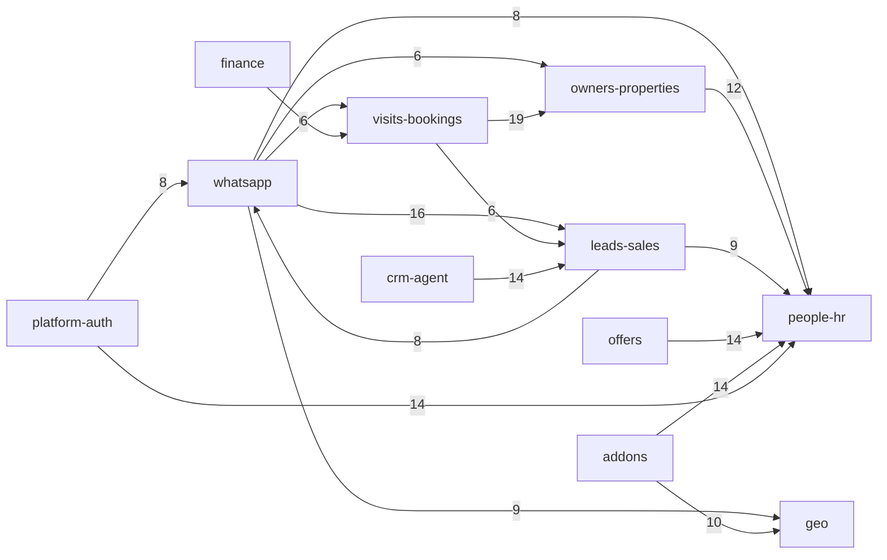

# Architecture review

Read-only review of Adminstro at `58a199fc` (2026-10-10). No application source was modified. Measurements are from a throwaway import walker (`/tmp/arch-review/analyze.mjs`), `madge` 8.0.0, `wc`, and `git log`. Raw output is in `docs/architecture-review-data/`.

Line counts below are `wc -l` for named files. The walker counted 1,433 source files and 293,525 newline-splits under `src/` plus `socket.ts` (about one higher per file than `wc -l` when the file ends in a newline).

## 1. Executive summary

**Health: 2 / 5.** The product is a single Next.js process with a real domain shape hiding inside it (WhatsApp, leads, owners, people, visits, finance), but nothing enforces that shape. Finance and the CRM agent are the only places that look designed. Everything else grew as route handlers, one server-action file, and copied page trees.

The five problems that dominate change risk:

1. **API auth is optional.** Middleware skips `/api`. 85 route files have no auth, webhook, or session check. One of them writes any field on a lead.
2. **Route handlers are the data layer.** 354 of 412 route files import Mongoose models. 36 import `src/services`.
3. **Domains are not allowed to own their data.** `Employees`, `Query`, `Property`, and `bookings` are imported and written from several domains. Thirteen domains form one strongly connected component.
4. **The largest files are also the most edited.** `queryActions.ts` (4,924 lines, 48 commits), `whatsapp.tsx` (3,610, 61), and the WhatsApp webhook (2,451, 33) sit on the churn list.
5. **Those files have no safety net.** Eight test files, 1,440 lines. The hotspots above are not among them.

**First move:** close the unauthenticated write and debug routes, then add dependency-cruiser (or an ESLint `no-restricted-imports` rule) whose ceiling is today’s 354 route-to-model imports. Do not start by splitting WhatsApp. Splitting a 2,451-line webhook while anonymous lead updates still exist will not make the system safer to change.

## 2. System overview

### Stack

| Concern | What the repo actually uses |
| --- | --- |
| Language | TypeScript, `strict: true`, path alias `@/*` → `src/*`. ESLint is only `next/core-web-vitals`. |
| App | Next.js 14.2.7 App Router, React 18, Tailwind, Radix, TanStack Query, Zustand (`src/AuthStore.ts`). |
| Process | `npm run dev` and `npm start` both run `tsx socket.ts`: one Node process serves Next, Socket.IO, and cron. |
| Database | MongoDB via Mongoose 8. Database name is hardcoded as `PropertyDb` in `src/util/db.ts`. No migration framework. One-off scripts in `src/scripts/`. |
| Queue | None found (no Bull, SQS, or Kafka). |
| Realtime | Socket.IO on the custom server, reached from route handlers through `(global).io`. A second path uses the Pusher SDK directly in room routes and lead pages. `src/lib/pusher.ts` is Socket.IO event names, not the Pusher client. |
| Jobs | `node-cron` inside the web process: password rotation, personal reminders, stale-session cleanup (`socket.ts` lines 9–11 and 22–24). |
| Integrations present in code | Meta WhatsApp Graph (`src/lib/whatsapp/config.ts`), Razorpay, Nodemailer, Expo push (`src/services/push`), ffmpeg in the WhatsApp webhook, Google Maps packages, CRM-agent local embeddings (comment in `src/services/crm-agent/rag/embeddings.ts` says Groq is the LLM and embeddings are local). |
| Declared but barely used | `graphql`, `apollo-server`, `apollo-server-micro`. `@apollo/client` is imported by `src/lib/apolloClient.ts` and, unused, by `src/app/api/room/getPropertiesOfUser/route.ts`. |

### Entry points

- `socket.ts` — HTTP server, Socket.IO, three schedulers, then `(global).io = io`.
- `src/middleware.ts` — page authorization only. The matcher excludes `api`.
- 412 `route.ts` / `route.tsx` handlers under `src/app/api/`.
- 125 `page.tsx` files.
- `package.json` scripts — seeds, backfills, index creation, CRM-agent eval. Not a job runner with a queue.
- No event-consumer process.

### Directory tree

Descriptions are from contents, not from the folder name alone.

```
Adminstro/
├── socket.ts                 Custom Next + Socket.IO server and cron host
├── src/
│   ├── app/
│   │   ├── api/              412 route handlers; the de facto business layer
│   │   ├── dashboard/        CRM UI (largest tree, ~87k lines). Many near-copy lead pages
│   │   ├── whatsapp/         Inbox client (components, hooks, containers)
│   │   ├── spreadsheet/      Long-term owner sheet
│   │   ├── spreadsheet-short-term/
│   │   ├── holidaysera/      HolidaySera UI
│   │   ├── housingsaga/      HousingSaga UI
│   │   ├── login/  application-form/  interview-reschedule/  employeeTable/  userTable/  norole/
│   │   ├── layout.tsx  page.tsx  middleware lives one level up in src/middleware.ts
│   ├── components/           218 files. shadcn `ui/` plus domain widgets (lead tables, sidebar, notifications)
│   ├── features/             Partial UI modules: sales, leadgen, advert, admin, people
│   ├── actions/              One server-action module, `(VS)/queryActions.ts` (4,924 lines)
│   ├── lib/                  Domain code for WhatsApp, leads, finance, people, plus loose clients
│   ├── services/             finance, crm-agent, visits, housingsaga, push, whatsapp-calling, a few loose files
│   ├── models/               59 Mongoose models, one flat folder, shared by every domain
│   ├── schemas/              Zod input schemas. Most routes do not import them
│   ├── util/                 DB connect, token auth, cron, mail, pricing rules. Not a pure utility layer
│   ├── hooks/  helper/       Client hooks; helper/ is mostly email HTML
│   ├── config/  constants/  types/  providers/  animations/  templates/  docs/
│   ├── routers/              Single file `types.ts`. Not a router layer
│   └── scripts/              Backfills and seeds run via tsx
├── __tests__/                3 Jest files
├── scripts/                  Build guard and a CRM-agent export
├── docs/                     Point-in-time audits (WhatsApp, leads, candidates, CRM agent). Not ADRs
└── public/  Jenkinsfile  .github/
```

`src/lib/whatsapp/` (about 14k lines, 70+ files) is a real module. `src/services/finance/` and `src/services/crm-agent/` are the other two. `src/util/`, `src/actions/(VS)/`, and the loose routes at `src/app/api/` root (`testing`, `debug-db`, `getallproperty`, `editPrices`, `visibiltychange`, `deleteimage`) are dumping grounds.

### Real modules

Bounded contexts inferred from models, routes, and who writes them. “Public surface” is what callers actually import. There is no `index.ts` barrel that other modules are required to use.

| Module | Purpose | Owned collections (Mongoose name) | Public surface today | Depends on |
| --- | --- | --- | --- | --- |
| platform-auth | Login, session cookie, page ACL | reads `Employees`, `HousingCollaborator` | `src/middleware.ts`, `src/util/getDataFromToken.ts`, `/api/employeelogin` | people-hr, housingsaga |
| whatsapp | Inbox, webhook, calls, retarget | `WhatsAppConversation`, `WhatsAppMessage`, `WhatsappChannel`, read-state, webhook logs, `RetargetContact` | `src/lib/whatsapp/*` imported file-by-file; routes under `/api/whatsapp` | leads (`Query`), people (`Employees`), owners, visits, geo |
| leads-sales | Guest leads and sales pipeline | `Query`, `WebsiteLeads` | `/api/leads`, `/api/sales`, and `queryActions.ts` | people, whatsapp, owners, offers, visits |
| owners-properties | Listings, owner sheets, users-as-owners | `Property`, `Users`, `unregisteredOwner`, `unregisteredOwnerShortTerm`, `listings`, `quicklisting`, `Owners`, `PropertyBooster` | Parallel route trees `/api/unregisteredOwners` and `...ShortTerm`, spreadsheet pages | people, visits, geo |
| people-hr | Employees, candidates, targets | `Employees`, `Candidate`, `Role`, `OfficeAddress`, monthly targets | `/api/employee`, `/api/candidates`, `/api/people`, candidate portal pages | visits, leads, whatsapp (thin back-edges) |
| visits-bookings | Visits, rooms, traveller bookings | `visits`, `bookings`, `Room`, `travellerBookings` | `src/services/visits/visitService.ts`, `/api/visits`, `/api/bookings`, `/api/room` | owners, leads, holidaysera |
| finance | Razorpay ledger and invoices | `FinancePayment`, `FinanceInvoice`, `RazorpayWebhookLog`, legacy `Invoice` | `src/services/finance/*`, `/api/finance/*` | visits (`bookings`) |
| offers | Sales offers and coupons-as-offers | `offer`, `Company` | `/api/offers`, `/api/sales-offer` | people, notifications, content |
| holidaysera | Holiday product | `holidayUsers`, `Subscription` | `/api/holidaysera`, `src/services/holidaySeraGuests.ts` | visits, owners |
| housingsaga | Collaborators and saga queries | `HousingCollaborator`, `HousingSagaQuery`, `HousingUsers`, `Payment` | `src/services/housingsaga`, `/api/housingsaga` | people, leads |
| crm-agent | Internal assistant | `CrmAgentConversation`, `CrmAgentAudit`, `CrmAgentKnowledge` | `src/services/crm-agent/index.ts` (callers still reach internals) | leads, owners, people, visits, whatsapp, finance |
| notifications | In-app notices, push, reminders | `SystemNotification`, `PersonalReminder`, `ExpoPushTokens`, `EmailTemplates` | `/api/notifications`, `/api/push`, schedulers in `src/util` | people, whatsapp |
| content | Blog, catalogue, coupons, questions | `Blog`, `catalogues`, `Coupon`, `Question`, `Aliases` | `/api/blog`, `/api/catalogue`, … | people |
| addons | Roles, areas, agents, brokers | `Agents`, writes `Area`, `Role`, `MonthlyTarget` | `/api/addons` | people, geo, owners |
| geo | City / area reference | `Area` | `/api/areaStats`, `src/lib/city-normalizer.ts` | owners, people |

**Classification**

- **Closest to well-bounded:** `src/services/finance` (Zod at the route, service functions, two test files) and `src/services/crm-agent` (guards, workflows, tests). Both still import foreign models. No module is strictly bounded.
- **Leaky:** WhatsApp (a real `src/lib/whatsapp`, then a 2,451-line route and a 3,610-line client that reach into leads and employees). People-hr (the employee document is the global policy object).
- **Entangled:** leads-sales ↔ whatsapp, visits-bookings ↔ owners-properties, finance → `bookings`.
- **Dumping grounds:** `src/util/` (62 files, 12 of them import models), `src/actions/(VS)/queryActions.ts`, `src/components/` outside `ui/`, one-off routes at the API root, `src/helper/EmailTemplate/`.

`ui-dashboard` in the walker (126 files, ~42k lines) is dashboard UI whose path did not match a domain token. Those pages mostly call APIs or `queryActions`, not models (only 4 UI files import models). The domain graph below therefore under-represents UI fan-out and over-represents server imports. That limit is noted in section 8.

### Dependency diagram

Arrow labels are file-to-file import edges with count ≥ 6, domains only (shared UI, `src/util`, and scripts omitted). The graph is one strongly connected component: the back-edges are thinner than the forward edges, but they chain.



## 3. Findings table

| ID | Title | Category | Severity | Effort | Modules |
| --- | --- | --- | --- | --- | --- |
| F-01 | API routes sit outside the auth middleware, and 85 have no auth check | operability | Critical | M | platform-auth, leads-sales, people-hr, addons, owners-properties |
| F-02 | Route handlers and one server action are the persistence layer | dependencies | High | L | all domains with routes |
| F-03 | Domains import each other’s models; thirteen domains are one cycle | dependencies | High | L | whatsapp, leads-sales, people-hr, owners, visits, finance |
| F-04 | Largest files are also the highest-churn files | coupling | High | L | leads-sales, whatsapp, people-hr, platform-auth |
| F-05 | Owner APIs and lead pages are copied trees | coupling | High | M | owners-properties, leads-sales |
| F-06 | `bookings` has multiple writers and there are zero multi-document transactions | data | High | L | finance, visits-bookings, whatsapp |
| F-07 | Three authorization mechanisms disagree | consistency | Medium | M | platform-auth, whatsapp |
| F-08 | Schedulers, sockets, and webhook memory assume one process, and password rotation logs secrets | operability | High | S | platform, people-hr, whatsapp |
| F-09 | Schema is edited in place; Mongoose options are wrong; model cache is mutated on import | data | Medium | M | leads-sales, people-hr, housingsaga |
| F-10 | Validation, errors, and DB connect are done differently in every route | consistency | Medium | L | all API domains |
| F-11 | Hotspot modules have essentially no tests | tests | High | M | whatsapp, leads-sales, people-hr, platform-auth |
| F-12 | Names and leftover dependencies describe a structure the code does not have | coupling | Low | S | content, visits-bookings |

## 4. Detailed findings

### Dependencies

#### F-02. Route handlers and one server action are the persistence layer

**Evidence.** 412 route files. 354 import `@/models/*`. 57 import `zod`. 36 import `@/services/*`. 180 files call `connectDb()` at module scope, so importing the route connects to MongoDB.

`src/app/api/finance/generate-invoice/route.ts` is the exception worth copying: auth helper, Zod `safeParse`, then `generateInvoice()` in `src/services/finance`.

The opposite pattern is the default. `src/actions/(VS)/queryActions.ts` is `"use server"`, calls `connectDb()` at import, and exports 41 functions that aggregate leads, visits, bookings, owners, holiday stats, candidates, and retarget numbers:

```1:26:src/actions/(VS)/queryActions.ts
"use server";

import { DateRange } from "react-day-picker";

import Query from "@/models/query";
import { connectDb } from "@/util/db";
import Employees from "@/models/employee";
import { Properties } from "@/models/property";
// ... Visits, MonthlyTarget, Bookings, unregisteredOwner, WebsiteLeads, Users, HolidayUsers
connectDb();
```

`src/app/api/whatsapp/webhook/route.ts` (2,451 lines) imports five models plus push, ffmpeg, and calling services, and connects at import:

```1:39:src/app/api/whatsapp/webhook/route.ts
import WhatsAppMessage from "@/models/whatsappMessage";
import WhatsAppConversation from "@/models/whatsappConversation";
import ConversationReadState from "@/models/conversationReadState";
import ConversationArchiveState from "@/models/conversationArchiveState";
import Employee from "@/models/employee";
// ...
connectDb();
```

Layer violations counted by the walker:

| Rule | Files |
| --- | --- |
| Transport (`src/app/api`, middleware, `socket.ts`) imports `src/models` | 354, all of them routes |
| UI imports `src/models` | 4 (`visit-modal.tsx`, `invoice-builder.tsx`, `owners/fetchOwners.ts`, `owners/ownerActions.ts`) |
| `src/util` imports `src/models` | 12 |
| `src/models` imports `src/lib` or `src/services` | 3 (`visit.ts`, `crmAgentConversation.ts`, `webhookInspectorEvent.ts`) |
| `src/lib` imports `src/app` | 3 (`lib/people/lifecycle.ts`, `lib/translate/messageTranslate.ts`, `lib/whatsapp/templateClassification.ts`) |

**Why it matters.** A change to a lead field is not localized. Dashboard code, sales routes, WhatsApp lookup, visit creation, and the CRM agent all embed the query shape. New work copies an existing route, so the 354 count grows. Onboarding takes the form of reading a 2,000-line handler.

**Fix.** Treat `src/services/finance` as the template. New routes may only call a function in `src/services/<domain>` or `src/lib/<domain>`. Freeze the 354 with the rule in section 6. Move `queryActions.ts` by vertical slice (lead stats, visit stats, booking stats), not as one rewrite. Leave the finance routes alone except where they write `bookings` (F-06).

#### F-03. Domains import each other’s models

**Evidence.** Madge 8.0.0 reports **15 circular dependency chains** (`docs/architecture-review-data/madge-cycles.txt`). Tarjan on the same resolver groups them into **6 file-level strongly connected components**, all inside UI folders except two:

- `queryActions.ts` ↔ `src/features/sales/hooks/useWeeksVisit.ts` (a server action imports a type from a client hook)
- `src/util/propertyTypeAllowList.ts` ↔ `src/util/propertyVisibilityRule.ts`

There is **one domain-level SCC** of 13 modules: whatsapp, leads-sales, people-hr, owners-properties, visits-bookings, finance, offers, notifications, holidaysera, housingsaga, content, geo, and the loose `service-other` bucket. It exists because the thick edges in the diagram have thin reverse edges (leads → whatsapp is 8 imports, people → whatsapp is 1, owners → leads is 1, visits → finance is 1).

Cross-domain model imports (files whose path domain is not the model’s owner):

| Model | Importers | Outside owner | Outside writers (heuristic) |
| --- | --- | --- | --- |
| `employee.ts` | 123 | 78 | offers 12, platform-auth 5, whatsapp 4, shared 4, leads 3, content 3 |
| `query.ts` | 70 | 27 | whatsapp 6, visits 3, crm-agent 1 |
| `property.ts` | 44 | 19 | visits 4, holidaysera 3, leads 2 |
| `booking.ts` | 17 | 11 | finance 6, whatsapp 1 |
| `whatsappConversation.ts` | 57 | 6 | leads-sales 1 |
| `candidate.ts` | 53 | 13 | owners 1, plus scripts |

WhatsApp reaching into leads is concrete: `src/lib/whatsapp/leadLookupService.ts`, `locationAccess.ts`, `guestPropertyTypeAccess.ts`, and `whatsappDispositionService.ts` import `@/models/query`.

Hub files (internal fan-in / fan-out):

| Fan-in | File |
| --- | --- |
| 405 | `src/util/db.ts` |
| 302 | `src/util/getDataFromToken.ts` |
| 219 | `src/util/axios.ts` |
| 128 | `src/util/type.ts` |
| 122 | `src/models/employee.ts` |
| 68 | `src/models/query.ts` |
| 56 | `src/models/whatsappConversation.ts` |
| 45 | `src/lib/whatsapp/config.ts` |

Highest fan-out is page and route files, not libraries: `candidatePortal/[id]/page.tsx` (31), `people/[candidateId]/page.tsx` (30), `whatsapp.tsx` (30), webhook route (25).

**Why it matters.** There is no seam to put a lint rule on until you name one. Any “WhatsApp change” can require a lead-schema change and an employee-schema change. The employee document (584 lines) carries auth sessions, pricing rules, property-visibility rules, and WhatsApp phone masks, so people-hr cannot change its schema without touching every product.

**Fix.** Do not try to delete the SCC in one pass. Allowlisted reads first: WhatsApp may call `lookupLeadByPhone()` and must not import `src/models/query`. Finance may call `applyPaymentToBooking()` owned by visits and must not import `src/models/booking`. Employee reads for auth stay in `getDataFromToken` only. Counts to ratchet are in section 6.

#### F-12. Names describe a structure the code does not have

**Evidence.** `src/lib/pusher.ts` starts with “WhatsApp Socket Events” and reads the global Socket.IO server:

```42:48:src/lib/pusher.ts
// Helper to get the global socket.io instance (server-side)
export const getIO = () => {
  if (typeof window !== "undefined") {
    console.warn("getIO called on client side");
    return null;
  }
  return (global as any).io || null;
};
```

The Pusher SDK is constructed separately in 12 files (`new Pusher(`), including eight `/api/room/*` routes and lead pages such as `src/app/dashboard/reviewLeads/lead-page.tsx`.

`src/app/api/room/getPropertiesOfUser/route.ts` imports `canUseAsyncIteratorSymbol` from `@apollo/client/utilities` and never uses it. `src/routers/` contains only `types.ts`. `docs/whatsapp-architecture-specification.md` line 3 still says repository `c:\Admin`.

**Why it matters.** New code follows the name. People will “integrate Pusher” by editing a Socket.IO helper, or add a GraphQL resolver because the dependency is already in `package.json`.

**Fix.** Rename `src/lib/pusher.ts` to something like `socketEvents.ts` when the next WhatsApp change touches it. Delete the Apollo import and, after a repo-wide confirm, the unused Apollo server dependencies. Not a first-wave project.

### Data

#### F-06. `bookings` has multiple writers, and nothing uses a transaction

**Evidence.** The walker found **no** `startSession`, `startTransaction`, or `withTransaction` under `src/` or `socket.ts`.

`bookings` is imported from visits, finance, and WhatsApp. Finance both reads and writes it:

```12:19:src/services/finance/bookingLedgerService.ts
import Bookings from "@/models/booking";
import {
  computeCompleteAdjustment,
  computePendingAmount,
  validateSplitAllocations,
  type SplitAllocationInput,
} from "@/lib/finance/paymentMath";
```

Two HTTP endpoints ingest Razorpay. `/api/razorpay/webhook` delegates to `processRazorpayWebhook`. `/api/payment-link/webhook` calls the same service with `skipBookingSync: true` and then updates `Bookings` and the legacy `Invoice` model itself (`src/app/api/payment-link/webhook/route.ts` lines 1–24). `syncBookingFromPaymentLink.ts` documents the dual path in a comment: it is “safe if `/api/payment-link/webhook` already updated the booking.”

There are two invoice collections: `Invoice` (`src/models/invoice.ts`) and `FinanceInvoice` (`src/models/financeInvoice.ts`). HousingSaga registers another model under the name `"Payment"` (`src/models/housingPayment.ts`), while finance uses `FinancePayment`.

**Why it matters.** A captured payment can update the ledger and the booking in separate requests with no rollback. The comment in the sync helper is the coordination mechanism. Scaling to a second Node process makes the race worse, not better. Invoice bugs will be fixed in whichever model the author opened.

**Fix.** Pick `FinanceInvoice` / `FinancePayment` as canonical and stop writing `Invoice` from new code. Move booking mutation into `src/services/visits` (or a single `applyPaymentToBooking` used by both webhooks). Add a Mongo transaction only around that function, not across the whole request. Confirm with finance which legacy `Invoice` documents still need to be read.

#### F-09. Schema is unmanaged

**Evidence.** There is no `migrations/` directory. Schema changes ship as `src/scripts/backfill*.ts` and `migrate*.ts`, invoked by hand from `package.json`.

`src/models/query.ts` uses `require:` (not Mongoose’s `required:`) on 15 fields. Those constraints are not enforced:

```13:16:src/models/query.ts
    duration: {
      type: String,
      require: [true, "Duration is Required"],
    },
```

Several models delete themselves from the global Mongoose cache at import so hot reload picks up schema edits. `src/models/candidate.ts` lines 376–381 delete `models.Candidate`. `src/models/housingPayment.ts` deletes `mongoose.models.Payment` before registering `"Payment"`. Import order decides which schema wins.

`src/app/api/notifications/broadcast/route.ts` lines 10–23 drops a Mongo index as a side effect of handling a request.

Employee shape is declared twice: a 360-line Zod object in `src/schemas/employee.schema.ts` and a hand-written Mongoose schema in `src/models/employee.ts` (584 lines). The model imports the Zod *type* (`EmployeeSchema`), not the runtime schema, so the two can drift.

**Why it matters.** Production documents and the TypeScript types disagree, and the only signal is a bug report. Index drops and model-cache deletes are order-dependent and invisible in review.

**Fix.** Add a checked-in index script that is already the direction of `src/scripts/createIndexes.ts`, and stop dropping indexes from request handlers. Fix `require` → `required` only with a data audit (existing documents may not satisfy the rule). Do not introduce a SQL-style migration framework for Mongo until the model ownership in F-03 exists; a second schema tool on top of 59 shared models will fork again.

### Coupling

#### F-04. Largest files are the files that change every week

**Evidence.** Last 12 months (`git log --since=2025-10-12`): 499 commits, authors `abhay6969` (243), `aryan216` (225), `root` (28), `Aniket Yadav` (3). Decision-token counts are a rough scan (`if`, loops, `catch`, `case`, `&&`, `||`, `?`), not certified cyclomatic complexity. Brace-matched function spans are exact enough to show that the page *is* the function.

| Lines (`wc -l`) | Decision tokens | File | Verdict |
| --- | --- | --- | --- |
| 4924 | 706 | `src/actions/(VS)/queryActions.ts` | God module. 41 exports, 10+ collections, 48 commits, 7 bug-fix subjects |
| 3610 | 836 | `src/app/whatsapp/whatsapp.tsx` | God component. `WhatsAppChatInner` is lines 294–3610. 61 commits, 9 bug-fix subjects |
| 3605 | 533 | `src/app/dashboard/candidatePortal/[id]/page.tsx` | God page. `CandidateDetailPage` is lines 137–3605. 41 commits |
| 3552 | — | `src/helper/EmailTemplate/email.tsx` | Template blob, low decision count. Leave it |
| 3135 | 538 | `.../candidatePortal/[id]/onboarding/page.tsx` | Same portal, second god page |
| 2451 | 628 | `src/app/api/whatsapp/webhook/route.ts` | God handler. 33 commits, 3 authors |
| 2223 | 290 | `src/app/api/candidates/onboardingDocument/route.ts` | God handler, and it is on the no-auth list (F-01) |
| 1967 | 65 | `src/components/sidebar.tsx` | Navigation god file. 59 commits. Co-changes with `middleware.ts` in 43 commits |

`src/middleware.ts` is only 551 lines but is the **most committed file in the repo (67 commits, 4 bug-fix subjects)**. It co-changes with `sidebar.tsx` because each new page is an entry in a role→path table and a sidebar link.

**Why it matters.** The files people must edit to ship a feature are the files most likely to conflict and the files with the most branches. A WhatsApp search fix (the current uncommitted work) lands in the same webhook and client that also own calling, ffmpeg, and push.

**Fix.** Order is in section 7. Characterization tests for `canAccessConversation` already exist; extend that pattern to webhook event dispatch and to three `queryActions` exports before moving code. Split pages only after the data they fetch lives in a function with a test.

#### F-05. Copied trees

**Evidence.** Eight route pairs under `src/app/api/unregisteredOwners/` and `src/app/api/unregisteredOwnersShortTerm/`. Normalized Jaccard (identifiers `unregisteredOwner(s)(ShortTerm)` collapsed) is ≥ 0.74 for every pair:

| Pair | Raw Jaccard | Normalized | Lines |
| --- | --- | --- | --- |
| `nearby/route.ts` | 0.96 | 0.97 | 764 / 751 |
| `getAvailableList/route.ts` | 0.92 | 0.98 | 169 / 169 |
| `getNotAvailableList/route.ts` | 0.92 | 0.98 | 177 / 177 |
| `getCounts/route.ts` | 0.90 | 0.98 | 132 / 132 |
| `getList/route.ts` | 0.88 | 0.96 | 63 / 63 |
| `updatePetStatus/route.ts` | 0.86 | 0.95 | 63 / 63 |
| `addUser/route.ts` | 0.79 | 0.86 | 114 / 128 |
| `updateData/[_id]/route.ts` | 0.69 | 0.74 | 160 / 141 |

Eight dashboard `lead-page.tsx` files (`declinedleads`, `rejectedleads`, `closedleads`, `reviewLeads`, `goodtogoleads`, `notReplying`, `rolebaseLead`, `reminders`), 422–626 lines each. Jaccard against `goodtogoleads/lead-page.tsx` is 0.45–0.54. Same skeleton, diverged copies. Git shows several of them with 3 authors and double-digit commits (`rolebaseLead` 18, `goodtogoleads` 16, `declinedleads` and `rejectedleads` 13).

`/api/leads/*` and `/api/sales/*` repeat the same status nouns (`getRejectedLeads`, `getClosedLeads`, reminders). Not byte-identical; same workflow, two doors.

**Why it matters.** A pet-status or geo fix has to be applied twice or the short-term sheet silently drifts. That is already visible: `updateData` has diverged to 0.69 raw similarity. Lead-page bugfixes show up as a series of near-duplicate commits.

**Fix.** One owner-list service parameterized by collection (`unregisteredOwner` vs `unregisteredOwnerShortTerm`). Keep both HTTP paths until clients move, but they should call the same function. For lead pages, one table component with a status prop after F-02 gives it a single query function. Do not merge the files by hand before that function exists.

### Consistency

#### F-07. Three authorization mechanisms disagree

**Evidence.** Page access is a hand-maintained map in `src/middleware.ts`. `Admin` includes `/dashboard/whatsapp-analytics` and does not include `/whatsapp` (lines 35–52). Service access treats `Admin` as full WhatsApp access:

```129:147:src/lib/whatsapp/config.ts
export const FULL_ACCESS_ROLES = [
  "SuperAdmin",
  "Admin",
  "Developer",
] as const;

export const WHATSAPP_ACCESS_ROLES = [
  "SuperAdmin",
  "Admin",
  "Advert",
  "Sales",
  "sales-intern",
  "Sales-TeamLead",
  "LeadGen",
  "LeadGen-TeamLead",
  "Developer",
] as const;
```

`README.md` documents this exact split (Admin is full access in services and blocked from the inbox by middleware). The code and the README agree with each other; both disagree with the idea of one policy.

API identity is a third mechanism: `getDataFromToken` (374 lines, fan-in 302) verifies the JWT, special-cases `accountId === "test-superadmin"`, and loads either `Employees` or `HousingCollaborator`. It re-reads the employee on every call. Middleware never runs for `/api` (`src/middleware.ts` lines 546–550).

**Why it matters.** Adding a role means editing the middleware table, the sidebar, `WHATSAPP_ACCESS_ROLES`, and whatever route remembered to call `getDataFromToken`. The README is already a workaround for a bug the type system cannot see.

**Fix.** One role-policy module that both middleware and `getDataFromToken` call. Page paths and WhatsApp capability flags should be data in that module, not two lists. Keep the known Admin inbox exception as an explicit flag so it stops being tribal knowledge.

#### F-10. Validation, errors, and connect style

**Evidence.**

- Zod import in 57 / 412 routes. Finance uses `safeParse` and `{ success, message, errors }`. `src/app/api/sales/queryStatusUpdate/route.ts` checks a string `id` by hand and returns `{ message }` or `{ message, error }`.
- Among routes, 381 files contain an `error:` key, 230 a `message:` key, 213 a `success:` key. Those overlap; there is no single envelope.
- 180 files invoke `connectDb()` at top level. Finance’s generate-invoice route correctly `await`s it inside the handler.
- Pagination is ad hoc (`skip` / `limit` / `page` appear in 77 route files). No shared cursor helper.
- Logging is `console.log` (746 call sites) and `console.error` (834). No `pino`, `winston`, Sentry, or OpenTelemetry import under `src/`.
- Dependency injection is not used. Services import models directly. Socket.IO is a global. `src/AuthStore.ts` is a Zustand store on the client (fan-in 82).

**Why it matters.** Clients cannot switch on one error shape. A thrown `connectDb()` at import time fails the route module before the handler’s `try`, which is why so many handlers still `await connectDb()` again. Observability of the webhook is a `console.log` prefix (`logWebhookNotify` in the webhook route).

**Fix.** Adopt the finance envelope `{ success, message, errors? }` for new routes only. Ban new top-level `connectDb()` with a lint rule (current count 180). Do not boil the ocean on the 381 existing `error:` responses.

### Tests

#### F-11. The files you must refactor have no tests

**Evidence.** Jest (`jest.config.cjs`) matches `**/__tests__/**/*.test.ts` only. No `collectCoverage`. Eight files, 1,440 lines:

| Lines | File | What it locks |
| --- | --- | --- |
| 523 | `src/services/finance/__tests__/invoiceWorkflow.integration.test.ts` | Finance invoice flow. Likely needs Mongo; not run for this review |
| 266 | `__tests__/access.test.ts` | `canAccessConversation` retarget rules |
| 175 | `src/services/crm-agent/__tests__/guards-and-intent.test.ts` | CRM agent guards |
| 146 | `src/services/crm-agent/__tests__/workflows.test.ts` | CRM agent workflows |
| 136 | `__tests__/upload-media.test.ts` | Media upload helper |
| 91 | `src/lib/finance/__tests__/paymentMath.test.ts` | Pure payment math |
| 74 | `__tests__/sales-offer-template-and-lookup.test.ts` | Offer template lookup |
| 29 | `src/util/__tests__/employeeActivitySession.test.ts` | Session helper |

No `describe.skip`, `it.skip`, or `test.skip` under the repo (a search for `xit(` false-matches `process.exit`). Coverage was not executed: the finance integration test is not obviously side-effect free, and a full Jest run against 293k lines is not a cheap check.

**Unprotected hotspots:** `queryActions.ts`, `whatsapp.tsx`, webhook route, `middleware.ts`, `getDataFromToken.ts`, `employee.ts`, candidate portal pages, both unregistered-owner trees, `sidebar.tsx`. WhatsApp’s only automated lock is retarget access in `__tests__/access.test.ts`.

**Why it matters.** F-02 and F-04 cannot be moved safely. The finance and CRM-agent folders show the team can write tests when a service boundary exists. The absence is concentrated where the boundary was never drawn.

**Fix.** Before extracting code, add characterization tests around `leadLookupService`, webhook event-type dispatch (pure function, no Mongo), and `getDataFromToken`’s role/account-type branches with the model mocked. Use the finance tests as the pattern for the booking writer once F-06 has a single function.

### Operability

#### F-01. The API is outside the page guard

**Evidence.** Middleware matcher:

```546:550:src/middleware.ts
export const config = {
  matcher: [
    // Run middleware on everything except API routes, Next.js internals, favicon, and static files
    "/((?!api|_next/static|_next/image|favicon.ico|.*\\.(?:png|jpg|jpeg|gif|svg|webp|ico|pdf)).*)",
  ],
};
```

Of 412 routes, 316 reference `getDataFromToken`, `jwtVerify`, `jwt.verify`, `requireSuperAdmin`, `requireFinance`, or `getToken`. 96 do not. Of those 96, 11 have some other signal (local `_auth`, Bearer, Razorpay or Meta signature). **85 have none.**

Confirmed write with no auth check: any client can set any field on a lead.

```5:16:src/app/api/leads/updateData/[id]/route.ts
export async function PUT(req: NextRequest,{ params }: { params: { id: string } }) {
  try{
    const body = await req.json();
    const { id } = params;
    const data = await Query.findById( id );
    if (data) {
      data[body.field] = body.value;
      await data.save();
```

`src/app/api/sales/queryStatusUpdate/route.ts` marks any query viewed given an id (lines 8–26). `src/app/api/addons/roles/addRole/route.ts` creates roles with no session check (lines 7–10). `src/app/api/debug-db/route.ts` returns Mongoose and Employee model keys. `src/app/api/testing/route.ts` reads properties and users. `src/app/api/public/[model]/[id]/route.ts` returns an employee (password fields stripped) or a **candidate document with no projection** to anyone who knows the id. `src/app/api/public/[model]/route.ts` lists them.

Candidate onboarding routes (16 files in the no-signal set, including the 2,223-line `onboardingDocument` route) may be intentionally public for applicants. That is not confirmed. See section 8.

`/api/razorpay/webhook` returns **HTTP 200** on a fatal error (lines 29–34), so Razorpay will not retry. There is no `/api/health` route.

**Why it matters.** This is not a style issue. Page ACLs do not apply to the API, and several mutating handlers never grew a check. Mass assignment on `Query` bypasses every lead-status rule implemented elsewhere.

**Fix.** Add `getDataFromToken` (or a thinner `requireEmployee`) to every route in the 85 that is not a deliberate public or webhook endpoint. Reject unknown `field` names in `updateData` with an allowlist, or delete the route. Remove `debug-db` and `testing`, or gate them on SuperAdmin. Put candidate document fetches behind a signed token if they must stay unauthenticated. Do this before structural refactors.

#### F-08. One process owns HTTP, sockets, cron, and secret logs

**Evidence.** `socket.ts` starts the schedulers before it listens, then publishes the socket server globally:

```336:337:socket.ts
  // ✅ Make Socket.IO globally accessible (for Next API routes)
  (global as any).io = io;
```

`src/util/dailyPasswordRotation.ts` registers cron `* 22 * * *` unless `PASSWORD_ROTATION_CRON` is set (lines 131–141). In five-field cron that is every minute during 22:00–22:59 Asia/Kolkata, not once at 22:00. `node-cron`’s `validate()` accepts both `* 22 * * *` and `0 22 * * *`; it does not tell you which one you meant. `rotatePasswordsNow` does not record that today already ran; each fire generates a new password. Whether production overrides the env var was not checked.

The same function writes the new password to stdout:

```120:122:src/util/dailyPasswordRotation.ts
      console.log(
        `✅ Password rotated for ${emp.email} | New Password: ${newPassword}`,
      );
```

The webhook keeps idempotency in process memory (`lastEmitMap`, `pushedForMessageUser` at lines 43–46 and 78–80). A second instance will double-push and will not share the debounce.

**Why it matters.** Password rotation is a correctness and credential-exposure bug independent of architecture fashion. The global socket and in-memory maps mean “run two replicas” silently breaks notifications and logout. `getIO()` returns null if a route is ever executed outside `socket.ts` (plain `next dev` does not set `global.io`; the npm script avoids that by always using `socket.ts`).

**Fix.** Change the default cron to `0 22 * * *`. Delete the password from the log line. Gate `rotatePasswordsNow` on `passwordExpiresAt` so a duplicate fire is a no-op. Leave “extract a worker process” until you actually run more than one instance; confirm that with the team first.

## 5. Hotspot list

Fix or fence these first. Rank is churn × size × coupling, not size alone.

| # | File | Why this one |
| --- | --- | --- |
| 1 | `src/app/api/leads/updateData/[id]/route.ts` | Small, and it is an unauthenticated mass-assignment write. Fix before any refactor. |
| 2 | `src/middleware.ts` | 67 commits / 12 months. Co-changes with `sidebar.tsx` (43) and the WhatsApp client (11). The role table is the change amplifier. |
| 3 | `src/actions/(VS)/queryActions.ts` | 4,924 lines, 48 commits, 7 bug-fix subjects, imports leads, visits, bookings, owners, holiday users, candidates. Module-scope `connectDb()`. Cycle into a client hook. |
| 4 | `src/app/whatsapp/whatsapp.tsx` | 3,610 lines, 61 commits, 9 bug-fix subjects, fan-out 30. UI and inbox policy in one component. |
| 5 | `src/app/api/whatsapp/webhook/route.ts` | 2,451 lines, 33 commits, 3 authors, in-memory maps, ffmpeg, push, five models. |
| 6 | `src/models/employee.ts` | Fan-in 122, 78 importers outside people-hr, 23 commits. Auth, pricing, and visibility in one schema. |
| 7 | `src/util/getDataFromToken.ts` | Fan-in 302. Every “secured” route depends on a 374-line function that hits MongoDB. |
| 8 | `src/components/sidebar.tsx` | 1,967 lines, 59 commits. Changes whenever middleware changes. |
| 9 | `src/app/dashboard/(dashboard)/page.tsx` | 61 commits. Co-changes with `queryActions.ts` in 35 commits. The dashboard is a client of the god action. |
| 10 | `src/app/api/unregisteredOwners/nearby/route.ts` and its short-term twin | ~750 lines each, Jaccard 0.96. Highest-cost copy in the owner fork. |

`src/app/dashboard/candidatePortal/[id]/page.tsx` (3,605 lines, 41 commits) is the next page to split, after people-hr has a service and a test. It is omitted from the top ten only because F-01’s write routes and the middleware/queryActions/webhook cluster block more daily work.

## 6. Boundary rule candidates

Counts are the baseline to configure as “warn, do not decrease the ceiling” (ratchet). Allowlist the current files; fail CI on new violations.

| # | Rule | Current violations |
| --- | --- | --- |
| 1 | `src/app/api/**/route.ts` must not import `src/models/**` | **354 files** |
| 2 | `src/app/**` pages, `src/components/**`, and `src/features/**` must not import `src/models/**` | **4 files** |
| 3 | `src/actions/**` must not import `src/models/**` | **1 file** (`queryActions.ts`) |
| 4 | `src/util/**` must not import `src/models/**`, except `src/util/getDataFromToken.ts` and `src/util/db.ts` | **10 files** beyond those two (12 total) |
| 5 | `src/models/**` must not import `src/lib/**` or `src/services/**` | **3 files** |
| 6 | `src/lib/**` must not import `src/app/**` | **3 files** |
| 7 | `src/lib/whatsapp/**` must not import `src/models/query.ts` | **4 files** |
| 8 | Files outside `src/lib/whatsapp`, `src/app/api/whatsapp`, `src/app/whatsapp`, and `src/models/whatsapp*` must not import `src/models/whatsappConversation.ts` | **6 files** |
| 9 | Files outside `src/services/visits`, `src/app/api/visits`, `src/app/api/bookings`, and `src/models/booking.ts` must not import `src/models/booking.ts` | **11 files** (6 of them finance) |
| 10 | Files other than people-hr routes, `src/lib/people/**`, `src/middleware.ts`, and `src/util/getDataFromToken.ts` must not import `src/models/employee.ts` | **78 files** outside the people-hr domain. The allowlist above is smaller than the domain, so encode the allowlist and expect a number in the 70s until auth is centralized |
| 11 | `src/app/**` and `src/components/**` must not import `src/middleware.ts` | **1 file** (`src/app/page.tsx` imports `defaultRoutes`) |
| 12 | Route files must not call `connectDb()` at module top level | **180 files** |
| 13 | `src/app/api/unregisteredOwnersShortTerm/**` must not exist as a copy of `unregisteredOwners` (same relative path, normalized similarity ≥ 0.7) | **8 pairs** |
| 14 | Production source must not import `@apollo/client` or `apollo-server` | **2 files** |
| 15 | No new file-level import cycle. Madge baseline | **15 chains** (6 SCCs) |

Rule 9 will fail the finance build on purpose. Either allowlist `src/services/finance/**` until F-06 is done, or make the rule the tracking metric for that fix. Do not turn on rule 1 as a hard fail tomorrow; 354 existing files would block every PR. Set `maxDepth` or a baseline file list.

Suggested tool: dependency-cruiser with `no-circular` and `not-to` rules, plus the Madge run already recorded. The walker script is not the long-term check.

## 7. Prioritized roadmap

### Fix first

These are safe without a module split, and later splits depend on them.

1. **F-01 allowlist.** Authenticate or delete `leads/updateData`, `sales/queryStatusUpdate`, `addons/roles/*`, `debug-db`, `testing`, and `public/[model]`. Confirm candidate onboarding with the team before locking it the same way.
2. **F-08 password scheduler.** Cron `0 22 * * *`, no password in logs, no-op if already rotated. Small, and it is dangerous on the default.
3. **Razorpay webhook status.** Return 5xx on fatal failure so the provider retries (`src/app/api/razorpay/webhook/route.ts`).
4. **Boundary ratchet, rules 1, 5, 6, 11, 12, 14, 15.** Baseline today’s counts. No behavior change.
5. **Characterization tests** for `leadLookupService`, webhook event dispatch, and token account-type branches. Without these, items in “fix later” are guesses.

### Fix later

Each item removes a reason the SCC exists. Do them in this order because later ones call earlier ones.

6. **Lead read API.** Extract the query builders already started in `src/lib/leads/` (`LeadQueryService`, `employeeLeadContext`) so `/api/leads/*` and `/api/sales/*` stop inlining Mongoose. Then point WhatsApp’s four `Query` imports at that function (rule 7 goes to 0).
7. **Split `queryActions.ts`** along the export groups (lead stats, visit stats, booking stats, owner counts, candidate counts). The dashboard page co-changes with this file; update it in the same PRs, one export group at a time.
8. **Thin the webhook.** Move the Meta payload switch into `src/lib/whatsapp/` or `src/services/whatsapp`. Leave HTTP verification in the route. The in-memory maps move with the service and become an explicit single-process comment, or a Mongo unique index on message id.
9. **Collapse the owner route pairs** onto one function (rule 13). Start with `nearby`, the largest copy.
10. **One booking writer** (F-06), then drop the finance allowlist on rule 9. Add the transaction there.
11. **One role policy** consumed by middleware and WhatsApp config (F-07). Sidebar reads the same map so the 43-commit co-change pair shrinks.
12. **Split god pages** (`whatsapp.tsx`, candidate portal) only after the functions they call exist. Splitting JSX first does not reduce domain coupling.

### Leave alone

- `src/components/ui/**` (shadcn). High fan-in, no business rules.
- `src/services/finance/**` internals and `paymentMath` tests, except the booking import tracked by rule 9.
- `src/services/crm-agent/**` structure. It is a cross-domain reader by design; keep it on service functions once those exist, do not fold it back into routes.
- `src/helper/EmailTemplate/email.tsx`. Large, low decision count, not on the churn top 20.
- Blog, catalogue, and traveller-question routes until someone is changing them.
- Geo `Area` documents, except the addons routes that write them without auth (those are F-01, not a geo redesign).

## 8. Unverified / needs human confirmation

- **Production process count.** In-memory webhook maps and in-process cron are only bugs if more than one Node process runs. `socket.ts` is written as a single VPS listener (`hostname` `0.0.0.0`). Confirm the deploy unit in `.github/workflows/deploy.yml` / Jenkins.
- **`PASSWORD_ROTATION_CRON` in production.** The default expression is every minute of hour 22. If the env var is `0 22 * * *`, production is fine and only the default is wrong.
- **Candidate routes without auth** (`/api/candidates/**`, offer letter, training agreement, onboarding document). They may be the applicant-facing portal. If so, they still need a signed token; they should not share a bucket with `debug-db`.
- **Which invoice collection is still read** by the old dashboard invoice builder (`src/app/dashboard/invoice/**`, which also has an import cycle).
- **Write attribution** in the model table is heuristic: a file that imports two models and contains any `updateOne` / `save` / `create` is counted as a writer of both. Direction is right; per-model precision is not.
- **`ui-dashboard` (126 files, ~42k lines)** was not assigned to a domain because the path is `src/app/dashboard/<page>`. Server coupling is still counted when those pages import a domain file. UI-only coupling inside the dashboard is not in the Mermaid diagram.
- **Live MongoDB** was not queried. Collection names in section 2 are the strings passed to `mongoose.model`, including generics. They were not checked with `listCollections`.
- **Test coverage percent** was not measured. Jest has no coverage config, and the finance integration test was not run.
- **`.env` was not reviewed.** Secrets in the environment file are out of scope. Hardcoded Pusher app keys in lead pages were seen and not classified as secrets (Pusher keys are public; the secret was not confirmed present or absent).
- **15 unresolved imports** in the walker, mostly `globals.css`, `.js` specifiers in seed scripts that resolve at runtime via `tsx`, a missing `@/util/geocodeNominatim`, and a commented import of `./dashboard/cr%%5E$ghzdkkxjuhgy789/page` in `src/app/page.tsx`.
- **Admin inbox mismatch** is documented in `README.md` and present in code. Whether product wants Admin in the inbox was not confirmed.
- **Historical audits** at the repo root (`AUTHENTICATION_ARCHITECTURE_HISTORY.md`, `WHATSAPP_*_AUDIT.md`, `DASHBOARD_*`) and under `docs/` were not line-checked against current code. `docs/whatsapp-architecture-specification.md` is dated July 2026 and still names `c:\Admin`. Treat them as notes, not as the design.

Questions for the team:

1. Are `/api/candidates/*` document and signature routes supposed to be public?
2. How many Node processes run in production, and is `PASSWORD_ROTATION_CRON` set?
3. Is legacy `Invoice` still generated, or only `FinanceInvoice`?
4. Should Admin open `/whatsapp`, or should `WHATSAPP_ACCESS_ROLES` drop Admin?
5. Are the short-term and long-term owner sheets required to stay separate products, or only separate collections?

## 9. Appendix

### Commands and tools

```
# inventory
find src/app/api -name route.ts | wc -l          # 405 named route.ts; walker found 412 including route.tsx
wc -l <hotspot files>

# git, since 2025-10-12 (499 commits)
git rev-list --count --since='2025-10-12' HEAD
git log --since='2025-10-12' --format='%an' | sort | uniq -c
git log --since='2025-10-12' --name-only --pretty=format:'COMMIT%x09%an%x09%s'

# cycles (madge 8.0.0)
npx --yes madge --version
npx --yes madge --circular --extensions ts,tsx --ts-config tsconfig.json src socket.ts

# import graph, fan-in/out, domain edges, model importers, route heuristics
node /tmp/arch-review/analyze.mjs
# writes /tmp/arch-review/metrics.json
# copied to docs/architecture-review-data/metrics.json

# duplicate trees
# normalized line-set Jaccard in a one-off node script (see metrics session)
```

Walker rules: TypeScript/TSX/JS under `src/` plus `socket.ts`. Imports matching `from '...'`, `export ... from`, and `import()`. `@/` and relative specifiers resolved with extensions and `index.*`. External packages ignored. Domain of a file is the API folder map, then `src/models/<file>` map, then path regex. Full maps are in the script, not in application source.

Not used: dependency-cruiser (Madge covered cycles; the walker covered domain edges), coverage, the test suite, MongoDB, the browser.

### Covered and skipped

**Covered:** every TS/TSX/JS import under `src/` and `socket.ts`; all 59 model files’ `mongoose.model` names; route auth/zod/service heuristics; git history from 2025-10-12 through 2026-10-10; the largest files and the no-auth routes that were opened (leads update, sales query status, roles, debug-db, testing, public model, finance generate-invoice, both Razorpay webhooks, password cron).

**Skipped:** `node_modules`, `.next`, `public/`, email HTML bodies, most of the 125 pages beyond the largest, line-by-line reading of all 412 handlers, contents of `.env`, runtime behavior, test execution, deploy pipeline logic beyond noting Jenkins and `.github` exist.

### File-level cycles (Madge chains)

See `docs/architecture-review-data/madge-cycles.txt`. Fifteen chains. The invoice dashboard, catalogue page, target page, and filtered-properties page account for thirteen of them (UI barrels importing children that import the page). The two that cross a layer boundary are `queryActions.ts` → `useWeeksVisit.ts` and `propertyTypeAllowList.ts` ↔ `propertyVisibilityRule.ts`.

### Fan-in (top 10)

| Fan-in | Lines | File |
| --- | --- | --- |
| 405 | 28 | `src/util/db.ts` |
| 302 | 374 | `src/util/getDataFromToken.ts` |
| 250 | 57 | `src/components/ui/button.tsx` |
| 219 | 73 | `src/util/axios.ts` |
| 139 | 26 | `src/components/ui/input.tsx` |
| 128 | 924 | `src/util/type.ts` |
| 124 | 155 | `src/lib/utils.ts` |
| 123 | 195 | `src/hooks/use-toast.ts` |
| 122 | 584 | `src/models/employee.ts` |
| 91 | 161 | `src/components/ui/select.tsx` |

### Fan-out (top 10)

| Fan-out | Lines | File |
| --- | --- | --- |
| 31 | 3605 | `src/app/dashboard/candidatePortal/[id]/page.tsx` |
| 30 | 2889 | `src/app/dashboard/people/[candidateId]/page.tsx` |
| 30 | 3610 | `src/app/whatsapp/whatsapp.tsx` |
| 28 | 1515 | `src/app/dashboard/createquery/page.tsx` |
| 28 | 2019 | `src/app/spreadsheet/spreadsheetTable.tsx` |
| 25 | 2451 | `src/app/api/whatsapp/webhook/route.ts` |
| 25 | 675 | `src/features/admin/AdminDashboard.tsx` |
| 22 | 684 | `src/app/api/whatsapp/conversations/route.ts` |
| 22 | 1199 | `src/app/whatsapp/components/ConversationSidebar.tsx` |
| 22 | 690 | `src/app/whatsapp/containers/MessageThreadContainer.tsx` |

### Churn, last 12 months (top 15, excluding lockfiles)

| Commits | Authors | Bug-fix subjects | File |
| --- | --- | --- | --- |
| 67 | 2 | 4 | `src/middleware.ts` |
| 61 | 2 | 6 | `src/app/dashboard/(dashboard)/page.tsx` |
| 61 | 2 | 9 | `src/app/whatsapp/whatsapp.tsx` |
| 59 | 2 | 1 | `src/components/sidebar.tsx` |
| 48 | 2 | 4 | `src/util/type.ts` |
| 48 | 2 | 7 | `src/actions/(VS)/queryActions.ts` |
| 41 | 2 | 9 | `src/app/dashboard/candidatePortal/[id]/page.tsx` |
| 35 | 2 | 6 | `src/app/api/whatsapp/conversations/route.ts` |
| 33 | 2 | 3 | `src/app/whatsapp/components/ConversationSidebar.tsx` |
| 33 | 3 | 4 | `src/app/api/whatsapp/webhook/route.ts` |
| 29 | 2 | 4 | `src/models/candidate.ts` |
| 27 | 2 | 3 | `src/app/api/employeelogin/route.ts` |
| 23 | 2 | 0 | `src/models/employee.ts` |
| 23 | 2 | 5 | `src/app/api/whatsapp/send-template/route.ts` |
| 22 | 2 | 2 | `src/app/spreadsheet/spreadsheetTable.tsx` |

“Bug-fix subjects” means the commit message matched `fix|bug|hotfix|patch`. Messages in this repo are loose, so this is a lower bound on defect churn.

Strongest cross-module co-change: `middleware.ts` with `sidebar.tsx` (43 commits), `queryActions.ts` with `dashboard/(dashboard)/page.tsx` (35), `employee.ts` with `util/type.ts` (19), `whatsapp.tsx` with `sidebar.tsx` (15) and with `middleware.ts` (11).

### Domain size (walker line counts)

| Domain | Files | Lines | Routes |
| --- | --- | --- | --- |
| whatsapp | 218 | 59839 | 51 |
| ui-dashboard (unclassified pages) | 126 | 41915 | 0 |
| people-hr | 151 | 41756 | 81 |
| ui-shared | 243 | 36818 | 0 |
| owners-properties | 116 | 25069 | 63 |
| leads-sales | 83 | 11969 | 49 |
| shared | 75 | 11102 | 1 |
| visits-bookings | 71 | 10226 | 31 |
| finance | 53 | 9274 | 17 |
| offers | 51 | 8799 | 19 |
| crm-agent | 30 | 5042 | 4 |
| notifications | 29 | 3254 | 13 |
| housingsaga | 23 | 2911 | 6 |
| content | 33 | 2367 | 24 |
| holidaysera | 17 | 1833 | 8 |
| addons | 26 | 1763 | 24 |

### Route baseline

| Metric | Count |
| --- | --- |
| Route files | 412 |
| Import a model | 354 |
| Import zod | 57 |
| Import `@/services` | 36 |
| Central auth helper | 316 |
| No auth signal at all | 85 |
| Top-level `connectDb()` | 180 |
| `console.log` / `console.error` call sites | 746 / 834 |
| Mongo transactions | 0 |
| Test files / test lines | 8 / 1440 |
